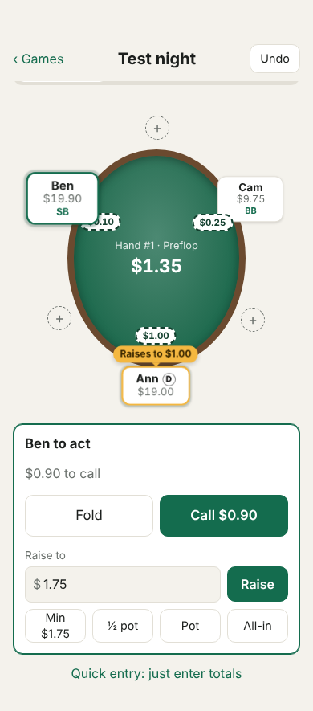

# Poker Tracker

Track in-person Texas Hold'em home games from your phone: blinds, turn order, side pots, split pots and who owes whom at the end of the night. Share a game with the whole table so everyone can follow along and enter their own actions.

**Live app:** https://poker-tracker-umber-one.vercel.app/

<p align="center">
  
</p>

---

## Contents

- [Features](#features)
- [How to use it](#how-to-use-it)
- [How it works](#how-it-works)
- [Tech stack](#tech-stack)
- [Getting started (development)](#getting-started-development)
- [Project structure](#project-structure)
- [Testing](#testing)
- [Deployment](#deployment)
- [Roadmap](#roadmap)
- [Known limitations](#known-limitations)
- [Docs](#docs)

## Features

**At the table**
- Automatic blinds, button rotation and turn order (including heads-up rules)
- Only legal actions offered: fold, check/call, bet/raise with min, ½ pot, pot and all-in shortcuts
- Correct minimum raises, and short all-ins that don't reopen betting
- Side pots for any number of all-ins, uncalled bets returned automatically
- Split pots divided down to the smallest chip, odd chips dealt from the left of the button
- **Quick entry**: skip action-by-action and just type what everyone put in
- Oval **table view** with stacks, bets, dealer button and blinds; the player to act is enlarged and the last action shows in a bubble

**Players**
- Add players any time, even mid-hand (they're dealt in next hand)
- Sit someone **between two players**: seats shift automatically
- Rebuys, sitting out (no missed blinds owed), leaving with their stack

**Mistakes happen**
- **Undo** the last action
- **Edit or delete** anything in the hand-by-hand log; anything that no longer makes sense afterwards is flagged, never silently skipped

**End of the night**
- Results for every player, including those who left early
- The **fewest payments** to settle everyone up
- **Chip-only games** (no money): plain chip counts and standings, no payments

**Shared games**
- The host starts a room and gets a 6-character code or link; no accounts needed
- Each player links their phone to their seat and enters their own actions on their turn; the host can enter anything for anyone
- Every phone updates live

## How to use it

### A game on one phone
1. Open the app, name the game, choose **Money** or **Chips only**, set the blinds, **Start game**.
2. Tap **+** on the table to add players (or **+ Add player** below it).
3. Pick the button and tap **Deal**. Blinds post automatically.
4. Tap the action for whoever's turn it is. For a bet or raise, type the amount ("raise **to**") or use the shortcuts.
5. At showdown, tap the winner (several for a split) and **Award**. Side pots are awarded last one first.
6. **Settle up** shows results and payments. **End game** when you're done.

Games on one phone are saved in that browser.

### A shared game
1. **Host:** tick **Share with other phones** when starting the game. Tap the room code to share the link.
2. **Players:** open the link, or tap **Join a game** and type the code, then tap **I'm [name]**.
3. When it's your turn, your phone says **Your turn**. Otherwise you'll see **Waiting for…**.
4. The host deals, awards pots, manages players and fixes mistakes. A player can undo their own last action.
5. If a phone dies, the host can free that seat under **Phones & seats** so a new phone can take it.

## How it works

The heart of the app is a **pure TypeScript poker engine** (`src/engine/`) with no React, browser or database code (enforced by an ESLint rule).

**Event sourcing.** A game is stored as a list of things people decided ("Ann raises to $1.00", "Ben wins the main pot"). Everything else is computed by replaying that list: blinds, streets, whose turn it is, pots, stacks. This makes undo trivial (drop the last event) and editing history safe (change an event and replay; the first event that no longer makes sense is reported).

**Money is integer cents.** Every amount is a whole number of cents and a multiple of the smallest chip ($0.05), so there are no rounding errors.

**Side pots** are built from each player's total contribution: the uncalled part of the biggest bet is returned, then pots are sliced at each all-in amount, with only players who reached that level eligible.

**Shared games** keep the same event log in Supabase (Postgres). Phones never write to tables directly; they call database functions that check permissions (host vs. player vs. watcher), event shape and size, and rate limits. Each write includes the version of the log the phone last saw, so if two phones tap at once, the second reloads, re-checks the move with the engine and retries or explains why it's no longer valid. Phones listen for changes over Supabase Realtime.

More detail: [`DESIGN.md`](DESIGN.md).

## Tech stack

| Part | Technology |
| --- | --- |
| UI | React 19, TypeScript, Vite (no UI library; plain CSS, light and dark) |
| Game engine | Pure TypeScript |
| Shared games | Supabase: Postgres, row-level security, SQL functions, anonymous sign-in, Realtime |
| Hosting | Vercel (front end), Supabase free plan (database) |
| Testing | Vitest (unit and property tests), SQL tests against Postgres |
| Tooling | ESLint, GitHub Actions (daily keep-alive) |

## Getting started (development)

**Requirements:** Node.js 20.19 or newer.

```bash
git clone https://github.com/stephenmoy14/poker-tracker.git
cd poker-tracker
npm install
npm run dev
```

Open the address it prints. To try it on a phone on the same Wi-Fi: `npm run dev -- --host` and open the "Network" address.

**Without Supabase**, everything works, and "Share with other phones" shares between tabs of the same browser (handy for trying it out).

**With Supabase**, copy `.env.example` to `.env.local` and fill in:

```bash
VITE_SUPABASE_URL=https://your-project.supabase.co
VITE_SUPABASE_ANON_KEY=sb_publishable_...   # the publishable (or legacy anon) key, never the secret key
```

Setting up the Supabase project itself (tables, functions, anonymous sign-in) is covered step by step in [`SUPABASE.md`](SUPABASE.md).

### Scripts

| Command | What it does |
| --- | --- |
| `npm run dev` | Start the dev server |
| `npm run build` | Typecheck and build for production |
| `npm run preview` | Serve the production build locally |
| `npm test` | Run tests in watch mode |
| `npm run test:run` | Run tests once |
| `npm run typecheck` | TypeScript check |
| `npm run lint` | ESLint (includes the engine-purity rules) |
| `npm run check` | Typecheck + lint + tests |
| `npm run test:db` | Database tests against a local Postgres (see [Testing](#testing)) |

## Project structure

```
src/
  engine/        Pure poker rules: hands, pots, awards, seats, replay, settlement, log text
  app/           React UI: screens, components, local storage, money/chip formatting
  sync/          Shared games: permission rules, conflict handling, Supabase and local backends
supabase/
  migrations/    SQL to run in Supabase, in number order
  tests/         SQL tests for the migrations
scripts/         test-db.sh (runs the SQL tests)
.github/         Daily keep-alive workflow
DESIGN.md        Design decisions and rules (read before changing the engine)
SUPABASE.md      Supabase setup guide
```

## Testing

- **Engine:** unit tests for every rule (blinds, min raises, short all-ins, side pots, odd chips, seating, settlement), plus **property tests** that play thousands of random hands and check that chips are never created or lost and that replaying the log always gives the same state.
- **Shared games:** tests with several simulated phones covering permissions, simultaneous taps, stale phones, undo, edits and seat claims.
- **Database:** SQL tests that run the real migrations on Postgres and check permissions, conflicts, rate limits and server-recorded authorship:

  ```bash
  PGHOST=localhost PGUSER=postgres npm run test:db
  ```

## Deployment

The app is a static site, so any static host works. It's set up on **Vercel**:

1. Import the GitHub repo in Vercel (Vite is detected automatically).
2. Add the environment variables `VITE_SUPABASE_URL` and `VITE_SUPABASE_ANON_KEY`.
3. Every push to `main` redeploys. Changing an environment variable needs a redeploy, because the values are built into the app.

**Keeping the free Supabase project awake:** free projects pause after about a week of inactivity. `.github/workflows/keep-alive.yml` pings the database daily; it needs the repo secrets `SUPABASE_URL` and `SUPABASE_ANON_KEY`. If the project does pause, the app shows "The game server is asleep" and the owner resumes it from the Supabase dashboard. See [`SUPABASE.md`](SUPABASE.md).

## Roadmap

**Next**
- [ ] Polish from real game nights (feedback welcome)
- [ ] Optional chip value for chip games, to turn standings into payments
- [ ] Admin page for the owner (list and clean up rooms, free a stuck host)

**Public online games** (design first, then build)
- [ ] Server-run hands: the server checks turn order and amounts, not just permissions
- [ ] Real card dealing with hidden hole cards, each phone sees only its own
- [ ] Turn timers and auto-fold for players who walk away
- [ ] Accounts or CAPTCHA on sign-in, and moderation tools
- [ ] Public lobby of open tables (play chips only)

**Ideas**
- [ ] Session history and stats across games
- [ ] Export a night's results to share
- [ ] Antes and straddles

## Known limitations

- **Turn order in shared games is checked on each phone**, not by the server. A deliberately tampered phone could add an out-of-turn action; it shows up as an invalid event for the host to delete. Fine among friends, and on the roadmap before public games.
- **The host is tied to one browser.** If the host clears their browser data, nobody can do host-only things in that room.
- **Shared games need a connection.** If it drops, entry pauses until it reconnects. Games on one phone work offline.
- **Rate limits are per sign-in**, so someone determined could dodge them with many anonymous sign-ins. Supabase's per-IP limit slows this; CAPTCHA would stop it.
- Several short all-ins that together add up to a full raise don't reopen betting (casino rule TDA 43 says they would).
- No antes or straddles yet.

## Docs

- [`DESIGN.md`](DESIGN.md): design decisions, poker rules as implemented, architecture
- [`SUPABASE.md`](SUPABASE.md): setting up Supabase, keep-alive, what to do if the project pauses

## License

No license has been chosen yet, so all rights are reserved by default. Open an issue if you'd like to use the code.
